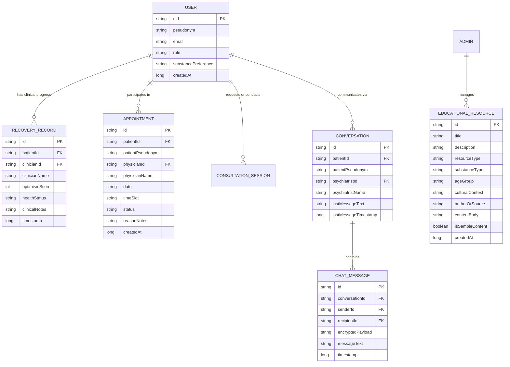

# Firebase Realtime Database Schema — Save Addicts

This document defines the proposed Firebase Realtime Database schema for Save Addicts, designed around user pseudonymity, clinical integrity, and minimal data exposure.

---

## 1. Schema Design Principles

1. **Strict Pseudonymity**: The database never stores civil ID numbers, passport copies, phone numbers, or residential addresses. User profiles are keyed exclusively by the Firebase Authentication `auth.uid`.
2. **Clinical Record Isolation**: Patient recovery records are stored under a separate node (`/recovery_records/$patientId`), editable exclusively by licensed physicians.
3. **Conversation Isolation**: Messages are partitioned under conversation nodes (`/messages/$conversationId/$messageId`) accessible only by the conversation's two participants.
4. **Public Educational Material**: Educational articles, books, and videos are kept in a readable public node (`/educational_resources`), write-restricted exclusively to Administrators.

---

## 2. Entity-Relationship Diagram



---

## 3. Node Definitions & JSON Hierarchy

```json
{
  "users": {
    "usr_patient123": {
      "uid": "usr_patient123",
      "pseudonym": "HopeSeeker42",
      "email": "patient@saveaddicts.org",
      "role": "PATIENT",
      "substancePreference": "OPIOIDS",
      "createdAt": 1729000000000
    },
    "usr_psych123": {
      "uid": "usr_psych123",
      "pseudonym": "Dr. Sarah Al-Sabah",
      "email": "psychiatrist@saveaddicts.org",
      "role": "PSYCHIATRIST",
      "substancePreference": "ALL",
      "createdAt": 1725000000000
    },
    "usr_phys123": {
      "uid": "usr_phys123",
      "pseudonym": "Dr. Ahmad Mansour",
      "email": "physician@saveaddicts.org",
      "role": "PHYSICIAN",
      "substancePreference": "ALL",
      "createdAt": 1724000000000
    },
    "usr_admin123": {
      "uid": "usr_admin123",
      "pseudonym": "System Administrator",
      "email": "admin@saveaddicts.org",
      "role": "ADMIN",
      "substancePreference": "ALL",
      "createdAt": 1720000000000
    }
  },

  "recovery_records": {
    "usr_patient123": {
      "rec_001": {
        "id": "rec_001",
        "patientId": "usr_patient123",
        "clinicianId": "usr_phys123",
        "clinicianName": "Dr. Ahmad Mansour",
        "optimismScore": 82,
        "healthStatus": "IMPROVING",
        "clinicalNotes": "Zero cravings reported. Patient actively engaged in mindfulness exercises.",
        "timestamp": 1729200000000
      }
    }
  },

  "appointments": {
    "apt_001": {
      "id": "apt_001",
      "patientId": "usr_patient123",
      "patientPseudonym": "HopeSeeker42",
      "physicianId": "usr_phys123",
      "physicianName": "Dr. Ahmad Mansour",
      "date": "2026-10-25",
      "timeSlot": "10:00 AM - 10:30 AM",
      "status": "CONFIRMED",
      "reasonNotes": "Routine clinical follow-up.",
      "cancellationReason": null,
      "createdAt": 1729100000000
    }
  },

  "conversations": {
    "conv_001": {
      "id": "conv_001",
      "patientId": "usr_patient123",
      "patientPseudonym": "HopeSeeker42",
      "psychiatristId": "usr_psych123",
      "psychiatristName": "Dr. Sarah Al-Sabah",
      "lastMessageText": "The breathing exercises helped me remain calm.",
      "lastMessageTimestamp": 1729250000000,
      "unreadCount": 0
    }
  },

  "messages": {
    "conv_001": {
      "msg_001": {
        "id": "msg_001",
        "conversationId": "conv_001",
        "senderId": "usr_patient123",
        "senderName": "HopeSeeker42",
        "senderRole": "PATIENT",
        "recipientId": "usr_psych123",
        "encryptedPayload": "ENC:DEMO:SGVsbG8gRG9jdG9y",
        "messageText": "Hello Doctor, I practiced the breathing exercises.",
        "timestamp": 1729250000000,
        "isRead": true
      }
    }
  },

  "consultation_sessions": {
    "sess_001": {
      "id": "sess_001",
      "patientId": "usr_patient123",
      "patientPseudonym": "HopeSeeker42",
      "psychiatristId": "usr_psych123",
      "psychiatristName": "Dr. Sarah Al-Sabah",
      "substanceType": "OPIOIDS",
      "status": "ACCEPTED",
      "initialNotes": "Requesting guidance on coping with sleep disruption.",
      "requestedAt": 1729150000000
    }
  },

  "educational_resources": {
    "res_001": {
      "id": "res_001",
      "title": "Understanding Opioid Neurochemistry & Healing",
      "description": "Scientific overview explaining neurological recovery timeline.",
      "resourceType": "VIDEO",
      "substanceType": "OPIOIDS",
      "ageGroup": "ADULT",
      "culturalContext": "GCC & International Context",
      "authorOrSource": "Addiction Recovery Institute",
      "contentBody": "In this lecture, neuroscientists discuss endorphin stabilization...",
      "isSampleContent": true,
      "createdAt": 1728000000000
    }
  }
}
```
