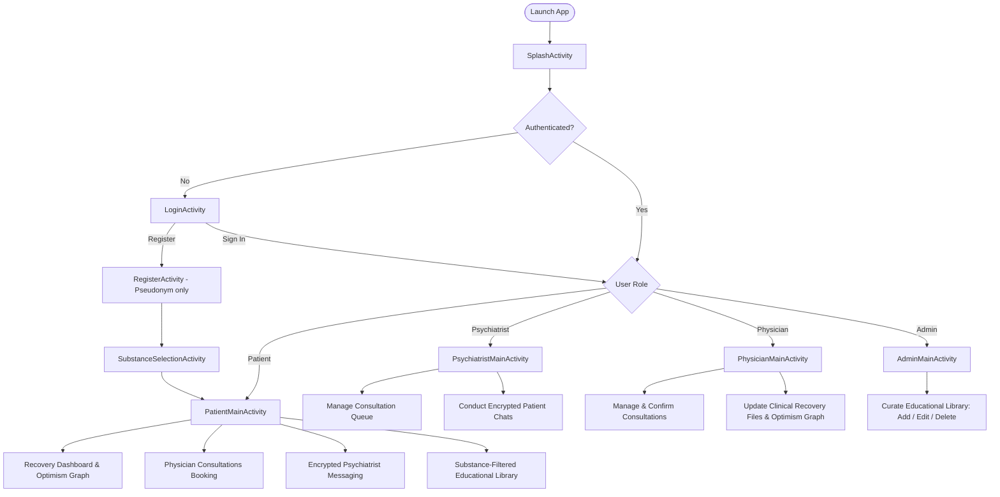

# Save Addicts — Android Application

**Save Addicts** is a confidential, privacy-first mobile healthcare and addiction recovery platform designed to overcome social stigma and provide accessible psychological and medical care. The platform connects individuals seeking recovery with licensed psychiatrists and physicians while strictly preserving user anonymity.

---

## 1. Project Background & Source of Truth

This application was engineered strictly from the authoritative specifications provided in:
1. `Save Addicts - Application Technical & Implementation Report.docx`
2. `SaveAddicts_Presentation1_Ghalia_211857 2.pdf` (Arab Open University - Kuwait, TM471 Final Year Project by Ghalia Madhram Almutairi, Supervised by Dr. Loai Shalaby)

### Core Mission
- **Dismantle Social Stigma**: In GCC and international communities, social stigma severely impedes recovery seeking. Traditional systems requiring national ID, phone numbers, or real identities create anxiety and deter help-seeking.
- **Absolute Pseudonymity**: The app enforces pseudonym-based sign-up without demanding government ID cards, passport numbers, or identity documentation.
- **Integrated Care Ecosystem**: Combines psychiatrist messaging, physician calendar scheduling, clinician-updated Optimism recovery tracking, and substance-filtered educational resources.

---

## 2. Technical Stack & Configuration

| Parameter | Specification |
|---|---|
| **Application Name** | `Save Addicts` |
| **Package Name** | `com.saveaddicts.app` |
| **Programming Language** | Java (JDK 17) |
| **UI Technology** | Android XML Views & Material Components (Material 3 DayNight) |
| **Minimum SDK** | API 28 (Android 9.0 Pie) |
| **Target / Compile SDK** | API 36 |
| **Build System** | Gradle 8.13 with Kotlin DSL (`build.gradle.kts`) |
| **Android Gradle Plugin** | AGP 8.13.2 |
| **Authentication Provider** | Firebase Authentication *(Integration prepared; currently running in local evaluation sandbox)* |
| **Database** | Firebase Realtime Database *(Schema prepared; currently running via in-memory repository)* |

---

## 3. Implemented Functional Requirements (FR1 – FR10)

| ID | Role | Feature | Status | Description |
|---|---|---|---|---|
| **FR1** | Patient | Anonymous Registration & Authentication | **Implemented** | Pseudonym-based sign-up, email authentication, session management, input validation, role routing, no identity documents requested. |
| **FR2** | Patient | Substance Selection & Content Filtering | **Implemented** | Post-registration substance selection (Alcohol, Opioids, Cannabis, Other, All), persistence, dynamic content tailoring. |
| **FR3** | Patient | Psychiatrist Secure Messaging | **Implemented** | Conversation thread list, messaging interface, timestamped messages, cryptographic envelope interface with explicit security disclosure. |
| **FR4** | Patient | Physical Appointment Booking | **Implemented** | Calendar date picker, doctor dropdown, conflict-aware time slot selection, notes, cancellation, and duplicate booking prevention. |
| **FR5** | Patient | Recovery Dashboard & Optimism Graph | **Implemented** | Canvas-rendered custom `OptimismGraphView` tracking clinician-evaluated recovery scores over time, health status badges, and empty states. |
| **FR6** | Patient | Educational Library | **Implemented** | Substance-filtered educational videos, books, and articles with age group tags, cultural context tags, and explicit sample content labeling. |
| **FR7** | Psychiatrist | Consultation Sessions Management | **Implemented** | Dedicated portal to view patient consultation queue, accept sessions, and launch encrypted psychiatric conversations. |
| **FR8** | Physician | Recovery Record Management | **Implemented** | Authorized access to patient clinical files, Optimism Graph trajectory preview, dated score updates (0-100%), and health status tracking. |
| **FR9** | Physician | Appointment Management | **Implemented** | In-person consultation dashboard to view scheduled bookings, confirm pending appointments, or cancel consultations with reasons. |
| **FR10** | Admin | Educational Content Management | **Implemented** | Administration portal to create, edit, categorize, and delete educational videos, books, and articles with substance/age metadata. |

---

## 4. Application Architecture

```
d:\SOAD\app\src\main\java\com\saveaddicts\app\
├── MainActivity.java                       # Router to SplashActivity
├── models\                                 # Core data models
│   ├── UserRole.java                       # PATIENT, PSYCHIATRIST, PHYSICIAN, ADMIN
│   ├── SubstanceType.java                  # ALCOHOL, OPIOIDS, CANNABIS, OTHER, ALL
│   ├── HealthStatus.java                   # IMPROVING, STABLE, MONITORING, CRITICAL
│   ├── AppointmentStatus.java              # PENDING, CONFIRMED, CANCELLED, COMPLETED
│   ├── ResourceType.java                   # ARTICLE, BOOK, VIDEO
│   ├── AgeGroup.java                       # ALL, YOUTH, ADULT, SENIOR
│   ├── SessionStatus.java                  # REQUESTED, ACCEPTED, COMPLETED, DECLINED
│   ├── UserProfile.java                    # Pseudonymous profile linked to UID
│   ├── RecoveryRecord.java                 # Clinician-updated dated score for Optimism Graph
│   ├── Appointment.java                    # Physician consultation booking
│   ├── ChatMessage.java                    # Message payload with cryptographic fields
│   ├── Conversation.java                   # Thread metadata between patient and psychiatrist
│   ├── EducationalResource.java            # Educational media item with sample tags
│   └── ConsultationSession.java            # Session request in psychiatrist queue
├── repositories\                           # Data abstraction boundaries
│   ├── Callback.java                       # Asynchronous operation callback
│   ├── AuthRepository.java                 # Authentication & profile contract
│   ├── AppointmentRepository.java          # Booking & schedule contract
│   ├── RecoveryRepository.java             # Recovery records & Optimism Graph contract
│   ├── MessagingRepository.java            # Chat messages contract
│   ├── EducationalRepository.java          # Educational resources contract
│   ├── UserRepository.java                 # User directory contract
│   ├── SessionRepository.java              # Consultation queue contract
│   ├── RepositoryLocator.java              # Central provider & future Firebase integration hook
│   └── mock\
│       └── MockDataRepository.java         # Thread-safe in-memory pre-seeded data store
├── security\                               # Access control & encryption boundaries
│   ├── AccessControl.java                  # Strict role authorization guards
│   ├── EncryptionService.java              # E2EE contract
│   └── DemoEncryptionService.java          # Transparent demo envelope with honest disclosure
├── adapters\                               # RecyclerView adapters
│   ├── AppointmentAdapter.java             # Appointments list adapter (role-aware)
│   ├── EducationalResourceAdapter.java     # Library items adapter (admin/user aware)
│   ├── ChatMessageAdapter.java             # Chat bubbles adapter (incoming/outgoing)
│   ├── ConversationAdapter.java            # Thread list adapter
│   ├── ConsultationSessionAdapter.java     # Psychiatrist queue adapter
│   └── PatientListAdapter.java             # Physician patient selection adapter
└── ui\                                     # Activities and Custom Views
    ├── components\
    │   └── OptimismGraphView.java          # Custom Canvas View for Optimism Timeline
    ├── SplashActivity.java                 # App entry point with session checking
    ├── LoginActivity.java                  # Sign in with 1-click Quick Evaluation buttons
    ├── RegisterActivity.java               # Anonymous sign up (FR1)
    ├── SubstanceSelectionActivity.java     # Substance category picker (FR2)
    ├── PatientMainActivity.java            # 4-tab Patient dashboard (FR2-FR6)
    ├── BookAppointmentActivity.java        # In-person doctor booking (FR4)
    ├── ChatActivity.java                   # Psychiatrist consultation chat (FR3)
    ├── ResourceDetailActivity.java         # Educational material reader (FR6)
    ├── PsychiatristMainActivity.java       # Consultation queue & chats (FR7)
    ├── PhysicianMainActivity.java          # Consultation & recovery portal (FR8, FR9)
    ├── UpdateRecoveryActivity.java         # Clinical score & Optimism updater (FR8)
    ├── AdminMainActivity.java              # Educational repository curator (FR10)
    └── AddEditResourceActivity.java        # Resource creation/edit form (FR10)
```

---

## 5. Application Workflow



---

## 6. Pre-Seeded Evaluation Accounts (Zero Friction)

For immediate testing, four pre-configured accounts are available in the local repository. The `LoginActivity` also features **1-click quick login buttons** to switch roles instantly:

| Role | Email | Password | Display Name | Pre-seeded Features |
|---|---|---|---|---|
| **Patient** | `patient@saveaddicts.org` | `password123` | `HopeSeeker42` | Pre-seeded with 4 dated Optimism Graph records (30% -> 82%), 2 appointments, active chat thread with Dr. Sarah. Focus: Opioids. |
| **Psychiatrist** | `psychiatrist@saveaddicts.org` | `password123` | `Dr. Sarah Al-Sabah` | 1 pending patient in queue (`NewDawn`), active conversation with `HopeSeeker42`. |
| **Physician** | `physician@saveaddicts.org` | `password123` | `Dr. Ahmad Mansour` | 3 scheduled consultations to confirm/manage, patient directory to update clinical records. |
| **Admin** | `admin@saveaddicts.org` | `password123` | `System Administrator` | 6 educational resources across videos, books, articles to curate or add new. |

---

## 7. How to Build & Run

### Prerequisites
- Android Studio Ladybug / Iguana or later
- Java Development Kit (JDK 17)
- Android SDK with Platform 36 (Min SDK 28)

### Building the Project
From the project root (`d:\SOAD`), run:

```powershell
# Assemble Debug APK
.\gradlew assembleDebug

# Run Automated Test Suite
.\gradlew test
```

### Generated Artifact Location
The verified debug APK is generated at:
```
d:\SOAD\app\build\outputs\apk\debug\app-debug.apk
```

---

## 8. Documentation Index

Detailed companion documentation is provided within the project:

- [`IMPLEMENTATION_STATUS.md`](file:///d:/SOAD/IMPLEMENTATION_STATUS.md) — Comprehensive functional status, test execution results, and limitations.
- [`FIREBASE_INTEGRATION.md`](file:///d:/SOAD/FIREBASE_INTEGRATION.md) — Step-by-step instructions to connect live Firebase Auth and Realtime Database.
- [`FIREBASE_SCHEMA.md`](file:///d:/SOAD/FIREBASE_SCHEMA.md) — Complete proposed Firebase Realtime Database schema with JSON representation.
- [`SECURITY_NOTES.md`](file:///d:/SOAD/SECURITY_NOTES.md) — Role-based access control rules, pseudonymity architecture, and E2EE roadmap.
- [`TEST_PLAN.md`](file:///d:/SOAD/TEST_PLAN.md) — Test cases covering functional, security, usability, and integration boundaries.
