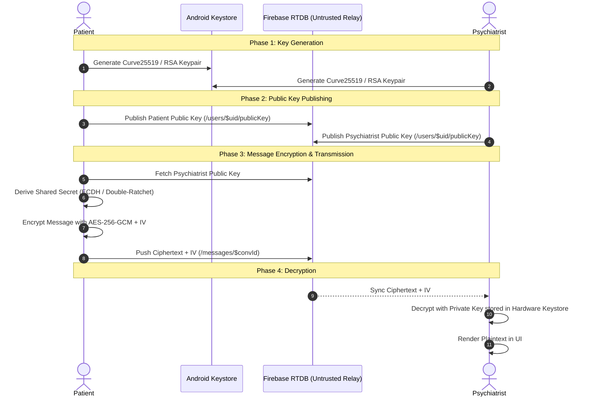

# Security, Privacy & Cryptographic Analysis — Save Addicts

This document details the security architecture, role authorization boundaries, privacy protections, and cryptographic requirements for Save Addicts.

---

## 1. Threat Model & Privacy Objectives

In substance addiction recovery—specifically within Kuwait, the GCC, and conservative communities globally—social stigma, reputational fear, and legal anxieties are paramount barriers preventing sufferers from seeking help.

### Core Security Objectives:
1. **Zero Personally Identifiable Information (PII)**:
   - No national identity numbers (e.g. Civil ID, National ID, Social Security Number).
   - No passport scans, driver's licenses, or biometric verifications.
   - No mandatory telephone numbers or real legal names.
2. **Clinical Integrity**:
   - Patients and system administrators must **never** be permitted to modify clinical assessments or fabricate Optimism Graph scores.
   - Modifying clinical recovery records is restricted exclusively to licensed physicians.
3. **Confidentiality of Consultations**:
   - Direct communication between patients and psychiatrists must be partitioned and cryptographically protected from third-party interception or server compromise.

---

## 2. Role-Based Access Control (RBAC) Matrix

| Operational Role | Anonymous Register | Update Recovery / Optimism Graph | Book Physician Appointment | Manage / Confirm Appointments | Conduct Psychiatric Sessions | Manage Educational Library |
|---|:---:|:---:|:---:|:---:|:---:|:---:|
| **Patient** | ✅ Yes | ❌ Read-Only | ✅ Yes | ❌ Cancel Own Only | ❌ Request Only | ❌ Read-Only |
| **Psychiatrist** | ❌ Pre-provisioned | ❌ Denied | ❌ Denied | ❌ Denied | ✅ Manage Queue & Chat | ❌ Read-Only |
| **Physician** | ❌ Pre-provisioned | ✅ Full Edit | ❌ Denied | ✅ Confirm & Manage | ❌ Denied | ❌ Read-Only |
| **Admin** | ❌ Pre-provisioned | ❌ Denied | ❌ Denied | ❌ Denied | ❌ Denied | ✅ Add, Edit, Delete |

### Client-Side Guard Enforcement
In [`AccessControl.java`](file:///d:/SOAD/app/src/main/java/com/saveaddicts/app/security/AccessControl.java), every privileged action is guarded programmatically:
```java
// Rejects any attempt to modify clinical recovery by non-physicians
AccessControl.requirePhysician(currentRole);

// Rejects any attempt to modify educational library by non-admins
AccessControl.requireAdmin(currentRole);

// Rejects any attempt to manage psychiatric queues by non-psychiatrists
AccessControl.requirePsychiatrist(currentRole);
```

---

## 3. Cryptographic Status & End-to-End Encryption (E2EE) Roadmap

### Critical Honest Disclosure
> [!IMPORTANT]
> **Transport Encryption (HTTPS/TLS) and Firebase Authentication DO NOT constitute End-to-End Encryption (E2EE).**
> In standard Firebase setups, database administrators and cloud backend nodes can inspect plaintext payloads stored in database nodes. True E2EE ensures that *only* the sender and recipient hold the cryptographic keys required to decrypt message content.

### Current Implementation State
- **Interface Contract**: An explicit [`EncryptionService`](file:///d:/SOAD/app/src/main/java/com/saveaddicts/app/security/EncryptionService.java) interface has been implemented.
- **Demonstration Container**: [`DemoEncryptionService`](file:///d:/SOAD/app/src/main/java/com/saveaddicts/app/security/DemoEncryptionService.java) packages message payloads inside an `ENC:DEMO:<Base64>` container to test UI flow, timestamp handling, and data pipeline without claiming production security.
- **`isProductionSecure()`**: Explicitly returns `false`, and `getSecurityNotice()` displays a banner warning in [`ChatActivity.java`](file:///d:/SOAD/app/src/main/java/com/saveaddicts/app/ui/ChatActivity.java).

### Production E2EE Architecture Requirements
To transition from the current evaluation interface to full production E2EE:



### Steps for Production E2EE Deployment:
1. **Key Generation**: Generate asymmetric key pairs (Curve25519 or RSA-4096) using the `AndroidKeyStore` provider to prevent key extraction even on rooted devices.
2. **Public Key Directory**: Store user public identity keys in `/public_keys/$uid` in Firebase Realtime Database.
3. **Session Protocol**: Integrate the Signal Protocol library (libsignal) or Double Ratchet algorithm for forward secrecy and post-compromise security.
4. **Independent Audit**: Perform third-party cryptographic review before deploying to production users.

---

## 4. Account Recovery & Password Management Decisions

### The Pseudonymity Tradeoff
Because Save Addicts does not bind accounts to verified phone numbers or government documents:
- **Email-Based Recovery**: The current architecture allows password resets via standard Firebase Auth email password reset links.
- **Disposable Email Guidance**: Users concerned with email traceability should be guided in user documentation to utilize privacy-focused pseudonymous email aliases (e.g., SimpleLogin, ProtonMail, or Duck.com aliases).
- **No Plaintext Passwords**: Passwords are never persisted in the Realtime Database. Only Firebase Auth handles cryptographic hashing (using scrypt).
